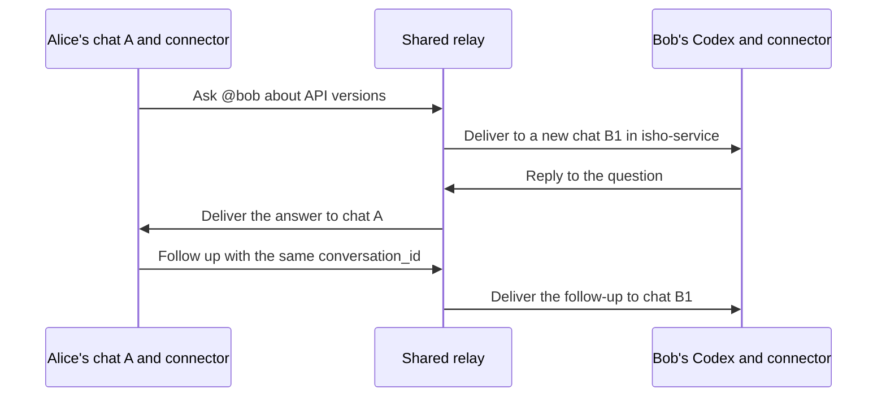

# Agent Relay

[简体中文](README.md) | **English**

Ask a teammate’s Codex a question from your current chat and get the answer back in that chat. Each person chooses which local project receives questions and who can ask.

> “Ask @bob which API versions his `isho-service` project supports.”

Bob’s Codex opens a chat in that project and sends its answer back to yours. Ask “What about older Android clients?” and the follow-up goes to the same chat on Bob’s machine. A separate question can start a fresh chat. Codex calls its local client through MCP. Each client connects out to the same self-hosted relay, so the computers can be on different networks. With both connectors and Codex hosts online and the tools approved, the exchange can continue while their owners are away.

## Install the client

On macOS or Linux with Node.js 24.5+ and npm, run this from any directory to install the `agent-relay` CLI from the public release.

```sh
npm install -g https://github.com/hdonLiu/agent-relay/releases/latest/download/agent-relay-client.tgz
agent-relay --help
```

If your team runs a relay, [register with it in Codex](#register-with-the-relay-in-codex). To pin a version, use the download URL of `agent-relay-client.tgz` from that specific release in the same install command. [Client releases](https://github.com/hdonLiu/agent-relay/releases)

## Try it on one Mac

You need Docker, Git, Node.js 24.5 or later, npm, and a compatible Codex CLI. The project has been tested with Codex `0.171.0-alpha.13.2`. This walkthrough uses one installed Codex and a script that plays the other participant.

```sh
git clone https://github.com/hdonLiu/agent-relay.git
cd agent-relay
docker build -t agent-relay:local-e2e .
docker run -d --name agent-relay-local --read-only -p 127.0.0.1:8787:8787 agent-relay:local-e2e
curl --retry 8 --retry-all-errors --retry-delay 1 -fsS http://127.0.0.1:8787/health
```

Once the health check returns `"status":"ok"`, run either test from the repository root.

```sh
npm ci
node scripts/e2e-local.js send
node scripts/e2e-local.js receive
```

- **Send** makes Codex ask the simulated peer a question, then checks that the returned value appears in the original chat’s response.
- **Receive** sends Codex a question about a file in a temporary project. It checks the file contents in the reply, sends a follow-up to the same chat, and verifies that a new topic opens a different chat.

Each test runs a separate Codex instance with scripted local model responses and prints a JSON result with the conversation, message, and thread IDs. Use `docker stop agent-relay-local` to stop the relay and `docker start agent-relay-local` to start it again.

## Connect two people

### Run one shared relay

Run the Docker build and start commands above on your relay host. For access from other computers, put the relay behind an HTTPS reverse proxy on the same host. Forward requests to `127.0.0.1:8787`, preserve request paths and the `Authorization` header, and enable WebSocket upgrades on `/v1/device-stream`. Each connector opens an outbound WebSocket and shares it across its chats. Use a relay you trust with the text of questions and answers.

<details>
<summary>Run the server directly with Node.js</summary>

From the repository root, build and install the server package, then start it behind your proxy.

```sh
npm ci
npm run build
npm pack --workspace @agent-relay/server
npm install -g ./agent-relay-server-0.1.0.tgz
agent-relay-server serve --host 127.0.0.1 --port 8787
```

To serve TLS directly, use `--host 0.0.0.0 --port 8443 --tls-cert fullchain.pem --tls-key privkey.pem` and include `:8443` in the HTTPS address given to clients.

</details>

### Register with the relay in Codex

After installing the client and signing in to Codex, each person adds the local MCP server on their computer. Replace the example URL with the address of your shared relay.

```sh
codex mcp add peer -- "$(command -v node)" "$(command -v agent-relay)" mcp --server https://relay.example.com
```

In Codex, Alice says **“Use peer to register this computer as @alice.”** Bob does the same with **@bob**. Once both names are registered, publish the projects and grant access. If you granted a name access before it was registered, rerun setup after registration. Replace the paths below with existing local project directories.

### Choose the projects that receive questions

Alice shares her application project with Bob.

```sh
agent-relay setup --server https://relay.example.com \
  --project /path/to/alice-project --target alice/app --allow bob
```

Bob shares his `isho-service` project with Alice.

```sh
agent-relay setup --server https://relay.example.com \
  --project /path/to/isho-service --target bob/isho-service --allow alice
```

Setup starts the connector as a macOS LaunchAgent or a Linux systemd user service. In a CLI-only setup, start the shared Codex host with `codex app-server daemon start` and open your chat with `codex --remote unix://`. If a chat was already open when you added the MCP server, reopen it to load the tools.

## Ask and follow up

In Alice’s chat, try **“Find @bob and ask which API versions are supported.”** If Bob has shared several online projects, pick an exact target such as `bob/isho-service`. When the question is accepted, keep working in Alice’s chat. Bob’s answer or request for clarification arrives there.

| MCP tool | How Codex uses it |
| --- | --- |
| `register_agent` | Register the local username and device through MCP. |
| `search_peers` | Find online projects that have granted the caller access. |
| `ask_peer` | Start with a `username` or `target`. Send follow-ups with the returned `conversation_id`. |
| `reply_to_peer` | Reference the incoming question’s `message_id` in `in_reply_to` and return `answered`, `needs_info`, or `needs_owner`. |



## Permissions and availability

- **Project access.** New recipient chats run with read-only access to the selected project and Codex’s minimal runtime paths. Sandbox networking is disabled and only the `peer` MCP server is enabled. To share an existing chat, publish a separate target alias with `--session-id <thread-id>` and address that alias explicitly. The existing chat keeps its owner’s permissions.
- **Delivery.** `accepted` means the recipient’s Codex has queued the input. If a device goes offline, its projects disappear from discovery and failed sends are not replayed. Once both devices reconnect, you can continue the conversation while the relay still has its routing record. For `DELIVERY_UNCONFIRMED`, check the receiving chat before sending again.
- **Relay restarts.** The relay runs as a single process and keeps registrations, permissions and conversation routes in memory. No database is required. After a restart, usernames can be claimed again. Each person registers, verifies the other username, and republishes the project with `setup --allow` before starting a new exchange. Previous chats remain in each person’s Codex.

<details>
<summary>Credentials, access changes and unattended use</summary>

Usernames start with a letter and accept 2–32 ASCII letters, digits, underscores or hyphens. Credentials stay in macOS Keychain or Linux Secret Service (`secret-tool`). Linux also requires `flock` from util-linux. To explicitly store credentials in private local files, add `--credential-store file` to the `agent-relay mcp` command when first registering.

Rerun setup for the same project and alias to change its allowed senders. The `--allow` values form the full replacement list. Use `--allow ''` to clear it. With `setup --manual`, run the connector yourself with `agent-relay daemon`. If you choose a custom `--state-dir`, use it for MCP, setup and the daemon.

For unattended exchanges, keep both devices and their local Codex hosts online. Each owner can preapprove the following tools in their Codex configuration and reload it.

```toml
[mcp_servers.peer.tools.search_peers]
approval_mode = "approve"

[mcp_servers.peer.tools.ask_peer]
approval_mode = "approve"

[mcp_servers.peer.tools.reply_to_peer]
approval_mode = "approve"
```

</details>

## Documentation

- [Architecture, transport and session routing (Chinese)](docs/design.md) · [Full sequence diagram (Chinese)](docs/flow.png)
- [Local Docker E2E report, including a live model run (Chinese)](docs/reports/2026-11-27-local-e2e.md)
- [Proposed group directory and invitations (Chinese)](docs/group-directory.md)
- Run `npm test` for the regression suite (requires OpenSSL), `npm run build` to build both packages, or `node scripts/smoke-codex.js` on a compatible Mac to check the Codex adapter.
