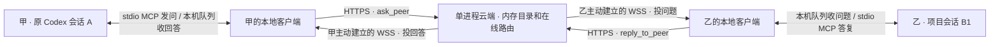

# Agent Relay

在自己的 Codex 会话里问同事的 Agent，让回答回到原会话。首问在同事授权的项目里新建会话，追问带上同一个 `conversation_id` 即可继续。双方在线时可以按用户名找到获准的项目。设备断线就停止投递，恢复在线后可以主动续问。



同一仓库构建两个安装包。运营方部署 `server/`，每位用户安装 `client/`。本地客户端包含 MCP 工具入口、后台连接器和宿主适配器。已实现 Codex，其他宿主可从适配器接入。[详细设计、协议和完整时序](docs/design.md)

## 构建安装包

使用 Node.js 24.5 或更高版本、npm 和 Git。测试还需要 OpenSSL。Linux 客户端使用 util-linux 提供的 `flock`，macOS 使用系统自带的 `lockf`。

```sh
git clone https://github.com/hdonLiu/agent-relay.git
cd agent-relay
npm ci
npm test
npm run build
npm pack --workspace @agent-relay/server
npm pack --workspace @agent-relay/client
```

macOS 上可额外运行 `node scripts/smoke-codex.js`，用已安装的 Codex、临时会话和本地模型响应检验原生入队、MCP 回信和同会话续聊。

把生成的包分发到对应机器。在云服务器上执行 `npm install -g ./agent-relay-server-0.1.0.tgz`，在甲乙各自的电脑上执行 `npm install -g ./agent-relay-client-0.1.0.tgz`。

## 启动云端

一期只部署一个 Node.js 进程，注册、授权、在线连接和协作路由都在内存中。启动时无需配置数据库、消息代理或数据卷。

```sh
agent-relay-server serve --host 127.0.0.1 --port 8787
```

让公网域名（下文用 `relay.example.com`）的 HTTPS 反向代理将请求转发到上述端口，保留 `Authorization`，并允许 `/v1/device-stream` 升级为 WebSocket。也可由服务直接终止 TLS，使用 `--host 0.0.0.0 --port 8443 --tls-cert fullchain.pem --tls-key privkey.pem`，客户端地址随之带上 `:8443`。公网客户端要求有效的 TLS 证书。服务健康检查为 `GET /health`。

## 接入 MCP，在 Codex 中注册

在装有客户端的电脑上添加本地 MCP，将示例地址替换为自己的中继服务：

```sh
codex mcp add peer -- agent-relay mcp --server https://relay.example.com
```

Codex 加载工具后，直接说 **“用 peer 把这台电脑注册为 @alice”**。本地工具 `register_agent({"username":"alice"})` 会在中继服务中登记用户名和设备，只向会话返回用户名、设备 ID 和注册状态。另一位用户在自己的电脑上用同样方式注册 `@bob`。注册在连接器启动之前即可完成。

用户名以字母开头，可使用 2–32 个英文字母、数字、下划线或连字符，系统按小写登记。同一台电脑重复注册同一个名字会返回原设备。已被别人登记的名字需换一个。凭据由本机生成并保存在系统凭据库。无系统凭据库的机器可在上面的 MCP 命令末尾显式添加 `--credential-store file`。双方注册完成后，各自选择要开放的本地项目和联系人。若项目所有者曾提前授权一个尚未注册的名字，需要在该用户注册后重新确认授权。

## 在两台电脑上登记项目

本地支持 macOS 和 Linux。Codex 需已登录，且其本机 app-server 支持代理连接、会话队列及 MCP 调用上下文。已对照的版本是 `0.171.0-alpha.13.2`。先在每台电脑上确认本地 Codex 能正常工作。仅使用 CLI 时，可用 `codex app-server daemon start` 启动本机共享进程，用 `codex app-server daemon version` 查看运行版本。希望将交互式 CLI 会话加入同一个共享进程时，使用 `codex --remote unix://`。

甲执行以下命令，把目录换成自己的工程目录。setup 自动使用 MCP 注册时保存在本机的身份。

```sh
agent-relay setup --server https://relay.example.com \
  --project /path/to/alice-project --target alice/app --allow bob
```

乙执行以下命令，把自己的 isho-service 项目开放给 alice。

```sh
agent-relay setup --server https://relay.example.com \
  --project /path/to/isho-service --target bob/isho-service --allow alice
```

默认使用 macOS Keychain 或 Linux Secret Service（需要 `secret-tool`）。setup 会向 Codex 注册名为 `peer` 的 stdio MCP 入口，并设置 macOS LaunchAgent 或 Linux 用户级 systemd 服务。若当前 Codex 会话尚未加载工具，重新打开该会话，并按宿主提示授权所需工具。设备在线、用户后台服务和本机 Codex 可用时可以无人收件，审批策略仍由电脑所有者决定。

若计划让两人离开后自动查找和问答，可以由各自的所有者在 Codex 配置中预授权以下工具，然后重新加载配置。实测版本使用以下 TOML：

```toml
[mcp_servers.peer.tools.search_peers]
approval_mode = "approve"

[mcp_servers.peer.tools.ask_peer]
approval_mode = "approve"

[mcp_servers.peer.tools.reply_to_peer]
approval_mode = "approve"
```

- **首问的项目权限**　自动创建的会话使用专用的只读工作区，以登记目录为根，同时保留 Codex 的最小平台运行路径（macOS 包括系统临时目录），关闭沙箱网络和其他已配置的 MCP。回信通过 `peer` 工具送出。
- **选择已有会话**　乙可为一个单独的别名添加 `--session-id <本机线程 ID>`，显式将获准的首问送进这个旧会话。客户端会核对该线程属于当前账号和登记目录。已有会话沿用所有者的工具和审批权限。
- **调整联系人**　对同一个目录和别名再次运行 setup，使用一个或多个 `--allow` 指定完整名单。`--allow ''` 清空该目标的联系人。
- **手动运行**　`setup --manual` 只登记设备和目标。已从 MCP 注册的用户保留原来的 MCP 入口，再在本机运行 `agent-relay daemon`。使用自定义状态目录时，这三个入口都要传入相同的 `--state-dir`。无系统凭据库的主机可显式选用 `--credential-store file`，凭据保存在当前用户的私有状态目录。

## 在 Codex 里使用

1. 甲在原会话 A 中说“找一下在线的 @bob，问他旧版客户端支持哪个接口版本”。`search_peers({"query":"bob"})` 列出乙对甲开放且在线的项目。有一个匹配项目时，甲可直接调用 `ask_peer({"username":"@bob","question":"旧版客户端支持哪个接口版本？"})`。有多个时，选择返回的项目别名并改用 `target` 发问。
2. 乙的连接器在乙自己登记的项目里新建 B1。B1 的宿主确认问题已入队后，甲的工具返回 `accepted`、`conversation_id` 和 `message_id`。业务答案稍后回到 A。
3. 乙用 `reply_to_peer` 回答，或以 `needs_info` 询问版本范围。甲带同一个 `conversation_id` 追问，问题继续进入 B1。甲重新用用户名发起另一件事，乙的项目会新建 B2。

## 上线和重启

| 情况 | 使用者会看到什么 |
| --- | --- |
| 一方休眠或断网 | 中继检测到断线后，该设备的项目从可搜索列表移除。发问或回信直接返回离线。恢复在线后，用户可沿原协作主动续问。 |
| 已经发出，回执超时或断线 | 工具返回投递未确认，并在中继已生成编号时带上消息号。先核对原协作或收件会话，避免把同一问题再次送达。 |
| 云端进程重启或发布新版本 | 用户名、设备登记、授权和协作号全部清空。双方分别在原 MCP 中再次调用 `register_agent`，确认彼此的用户名，再各自运行原来的 `setup --project … --allow …` 命令。使用 `--manual` 的用户自行重启本机连接器以加载配置。随后从原 Codex 聊天重新发起事项，对方会新建收件会话。 |

云端每次启动都有独立的用户名空间，重启后用户名可被先注册的人取得。原聊天记录由各自的 Codex 管理。本机保留凭据、项目配置和会话引用，方便设备短暂断线或连接器重启后续问。转发正文经过云端，部署者应使用团队信任的服务。

一期可用的目录是按联系人授权的在线项目列表。群邀请、入群即授权和群管理页面另见[群目录草案](docs/group-directory.md)。
