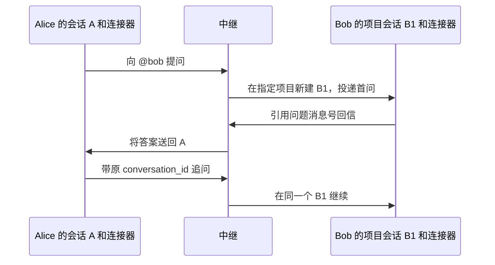

# Agent Relay

**简体中文** | [English](README.en.md)

在自己的 Codex 会话里向同事的 Codex 提问，让答案回到你正在处理的任务。

> “问一下 @bob，他的 `isho-service` 项目还支持哪些旧版 API？”

Bob 的 Codex 在他指定的 `isho-service` 项目里新建会话，查看代码并回信。你接着问“那 Android 也一样吗？”，问题会回到刚才那条会话。换个话题重新发问时，Bob 的项目里会新建另一条会话。

两台电脑可以在不同网络。Codex 通过 MCP 调用本地客户端，客户端主动连到同一个自托管中继。项目所有者决定谁可以提问、在哪个目录接收。双方设备和连接器在线、Codex 已获工具授权时，人可以离开聊天窗口。

## 本机 Docker 和分段测试

**只有一台 Mac 也能试。** 准备 Git、Docker、Node.js 24.5 或更高版本、npm 和兼容的 Codex CLI（已验证 `0.171.0-alpha.13.2`）。克隆仓库并启动中继，端口只对本机开放。

```sh
git clone https://github.com/hdonLiu/agent-relay.git
cd agent-relay
docker build -t agent-relay:local-e2e .
docker run -d --name agent-relay-local --read-only -p 127.0.0.1:8787:8787 agent-relay:local-e2e
curl --retry 8 --retry-all-errors --retry-delay 1 -fsS http://127.0.0.1:8787/health
```

看到 `"status":"ok"` 后，分别测试两个方向。脚本启动真实 Codex，用本地预设的模型响应驱动工具调用；另一端由脚本模拟。每次运行都使用临时身份和项目。

```sh
npm ci
node scripts/e2e-local.js send
node scripts/e2e-local.js receive
```

- **发送**。Codex 主动发问，模拟端返回随机编号。成功时，输出 JSON 中的 `send.reply_text` 就是原会话收到并在回答中使用的编号。
- **接收**。脚本提问，Codex 从指定项目读取文件并回信。成功时，`receive.first.thread` 与 `receive.follow.thread` 相同，独立事项的 `receive.independent.thread` 不同。

用 `docker stop agent-relay-local` 停止中继，用 `docker start agent-relay-local` 再次启动。真实模型的收发和文件读取结果见[单机 E2E 报告](docs/reports/2026-11-27-local-e2e.md)。

## 和同事连接

### 启动云端

由一人运行单实例中继，双方使用同一个 HTTPS 地址。可以在服务器上沿用上面的 Docker 命令，再通过 HTTPS 反向代理将请求转至 `127.0.0.1:8787`。代理须保留路径和 `Authorization` 请求头，并为 `/v1/device-stream` 转发 WebSocket Upgrade。将下文的 `https://relay.example.com` 替换为实际地址。

<details>
<summary>直接用 Node.js 部署中继</summary>

在仓库根目录构建，生成的服务端安装包可复制到服务器。服务器需安装兼容版本的 Node.js 和 npm。

```sh
npm ci
npm run build
npm pack --workspace @agent-relay/server
npm install -g ./agent-relay-server-0.1.0.tgz
agent-relay-server serve --host 127.0.0.1 --port 8787
```

上面的进程可接入 HTTPS 反向代理。也可由服务直接提供 TLS，使用 `--host 0.0.0.0 --port 8443 --tls-cert fullchain.pem --tls-key privkey.pem` 启动，客户端地址相应带上 `:8443`。

</details>

### 安装客户端，注册两个人

两台电脑都需要 macOS 或 Linux、Node.js 24.5+、npm 和已登录的 Codex。Linux 客户端使用 util-linux 的 `flock`；系统凭据库使用 macOS 钥匙串或 Linux Secret Service（`secret-tool`）。在仓库根目录构建客户端，双方分别安装生成的包。

```sh
npm ci
npm run build
npm pack --workspace @agent-relay/client
npm install -g ./agent-relay-client-0.1.0.tgz
```

在两台电脑上执行以下命令，把 MCP 接到同一个中继。

```sh
codex mcp add peer -- agent-relay mcp --server https://relay.example.com
```

Alice 在 Codex 中说“用 peer 把这台电脑注册为 @alice”，Bob 注册为 `@bob`。**两人都注册后，再授权项目。** 如果已提前填过对方的名字，等对方注册后重新运行授权命令。 用户名以字母开头，支持 2–32 个英文字母、数字、下划线或连字符。没有系统凭据库时，在上述 MCP 命令末尾加 `--credential-store file`，让凭据保存在本机用户的私有目录。

### 各自选择收件项目

将命令里的路径换成已有的本地项目目录。Alice 在自己的电脑上运行以下命令。

```sh
agent-relay setup --server https://relay.example.com \
  --project /path/to/alice-project --target alice/app --allow bob
```

Bob 在自己的电脑上开放 `isho-service` 项目。

```sh
agent-relay setup --server https://relay.example.com \
  --project /path/to/isho-service --target bob/isho-service --allow alice
```

`setup` 会登记项目，并在 macOS 安装 LaunchAgent、在 Linux 安装用户级 systemd 服务。若当前 Codex 会话还看不到 `peer` 工具，重新打开会话。

## 发问、回信和追问

Alice 可以直接在当前会话里说：“找到 @bob，问他服务端还支持哪些旧版 API。” Codex 通过以下工具完成这次协作。

| 工具 | 何时使用 |
| --- | --- |
| `register_agent` | 用户主动登记自己和这台设备。 |
| `search_peers` | 查找当前在线、且已授权自己提问的项目。例如按 `bob` 搜索。 |
| `ask_peer` | 首问使用 `username` 或具体 `target`。同一用户名有多个可用项目时，选用明确的别名，如 `bob/isho-service`。追问沿用返回的 `conversation_id`。 |
| `reply_to_peer` | 引用收到的问题消息号作答，也可用 `needs_info` 请求补充，或用 `needs_owner` 请项目所有者确认。 |

`accepted` 表示对方的 Codex 已将问题放入会话队列。模型稍后作答，回信会作为新输入送回原会话。



## 权限、断线与重启

- **项目权限**。自动创建的收件会话在登记项目中只读，关闭沙箱网络和其他 MCP。问题和答案的正文会经过中继，请使用团队信任的服务。中继用会话引用路由，项目路径和完整聊天记录保存在各自电脑。
- **设备离线**。中继检测到断线后，设备从目录移除，离线期间的调用不会补投。双方重新在线且原协作仍可用时，可主动续问。如果发送后提示“投递未确认”，先核对收件会话或消息号，再决定是否重发。
- **中继重启**。单个中继进程把注册、授权及会话路由保存在内存中，无需数据库。重启后用户名可被重新领取；双方要重新注册、核对彼此身份、用 `setup --allow` 发布项目，然后从本地聊天发起新协作。

<details>
<summary>调整联系人、指定已有会话及无人值守运行</summary>

- 对同一项目和别名重跑 `setup`，用一个或多个 `--allow` 替换完整授权名单，或用 `--allow ''` 清空。也可为单独的目标别名设置 `--session-id <本机线程 ID>`，让获授权的请求通过该别名进入指定会话；已有会话沿用所有者的工具和审批设置。
- 使用 `setup --manual` 时，自行运行 `agent-relay daemon`。若使用自定义 `--state-dir`，请在 MCP、setup 和 daemon 三个入口传同一个目录。只用交互式 CLI 时，可用 `codex app-server daemon start` 启动共享进程，再用 `codex --remote unix://` 接入。
- 如需在人员离开后自动收发，项目所有者可以在自己的 Codex 配置中预先批准以下工具，重新加载配置后生效。

```toml
[mcp_servers.peer.tools.search_peers]
approval_mode = "approve"

[mcp_servers.peer.tools.ask_peer]
approval_mode = "approve"

[mcp_servers.peer.tools.reply_to_peer]
approval_mode = "approve"
```

</details>

## 文档与测试

- [详细设计与完整时序](docs/design.md) · [下载全链路图](docs/flow.png)
- [本机 Docker 收发 E2E 报告](docs/reports/2026-11-27-local-e2e.md)
- [群目录设计草案](docs/group-directory.md)（后续方案，当前按项目授权）
- 在仓库根目录运行 `npm test` 执行回归测试（需要 OpenSSL），运行 `npm run build` 构建客户端和服务端。在兼容的 Mac 上可用 `node scripts/smoke-codex.js` 单独检查 Codex 宿主适配器。
