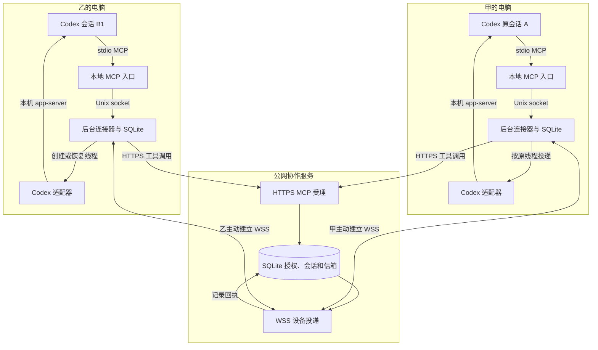
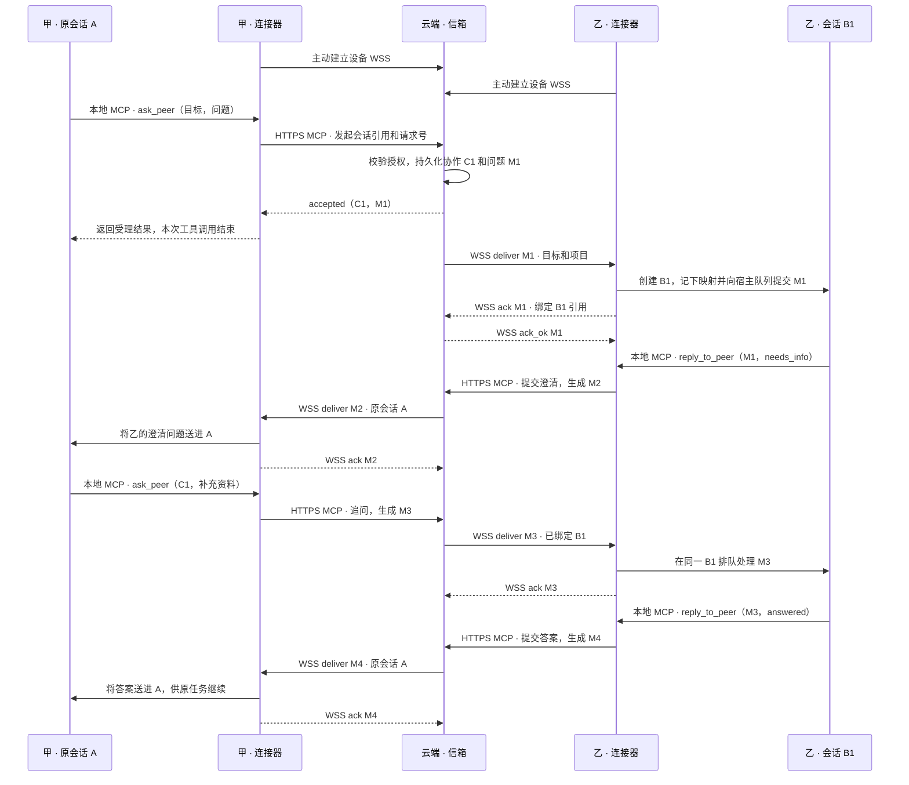

# Agent Relay 跨会话问答中间件详细设计

甲在 Codex 会话 A 里需要乙的项目知识时，可以把问题交给乙的 Agent。默认情况下，乙的电脑在指定项目创建会话 B1。乙的答案回到 A，甲继续处理原任务。双方可以离开聊天窗口，设备在线、连接器和本地 Agent 可用且工具已获授权时，问答仍可进行。设备离线期间由云端信箱保存消息。

这份文档对应仓库中的首版实现。当前提供 Codex 适配器。文中的 A、B1、C1 和 M1 等短编号仅用于读图。安装命令见[项目首页](../README.md)。

## 1. 怎样识别同一件事

| 甲或乙在做什么 | 工具调用 | 系统处理 |
| --- | --- | --- |
| 甲请乙核对接口兼容性 | `ask_peer(target, question)` | 冻结目标及甲的原会话，生成协作 C1 和问题 M1。乙首次收到时建立 B1 |
| 乙需要知道最低支持版本 | `reply_to_peer(in_reply_to=M1, outcome=needs_info, text)` | 为澄清问题生成新消息，送回 A |
| 甲补充最低版本 | `ask_peer(conversation_id=C1, question)` | 同一 C1 下生成问题 M3，路由到 B1 |
| 乙答复兼容范围 | `reply_to_peer(in_reply_to=M3, outcome=answered, text)` | 回到 A。A 可以依据答案继续原任务，也可再次追问 |
| 甲要另查一件事 | 再次通过 `target` 调用 `ask_peer` | 产生 C2，默认新建 B2。若乙显式发布了固定会话目标，新事项也进入该目标指定的会话 |

`conversation_id` 跨越多轮 Agent turn。每次逻辑调用立即返回自己的受理结果，乙的回答另行投递。`enqueued` 表示本地宿主已接受输入，实际业务结论来自乙的 `reply_to_peer`。

## 2. 进程与全链路

一个仓库包含云端 `server/` 和本地 `client/`。安装一个客户端即可兼做发件人与收件人。设备后台常驻一条主动向云端建立的 WSS，多个聊天共享这条连接。**无需每个会话保持 SSE，也无需云端连入个人电脑。** 网络断开后重新建立 WSS，从持久信箱补送。



| 代码位置 | 职责 |
| --- | --- |
| `server/registry/` | 用户和设备凭据、一次性登记码、稳定目标、别名、发件人授权与撤销 |
| `server/collaboration/` | 云端 SQLite、首问和追问的事务、受理幂等、两端绑定和诊断查询 |
| `server/delivery/`、`server/http.js` | 信箱排序、推送、确认、故障通知。HTTP 入口同时提供管理 API、MCP 和 WebSocket 升级 |
| `client/mcp/`、`protocol.js` | 向宿主暴露两个 stdio MCP 工具。与云端共享工具参数定义 |
| `client/connector/` | 同用户 Unix socket、出入站账本、WSS 心跳重连、按协作串行的本地投递 |
| `client/adapters/` | 宿主类型登记、可信调用身份、会话创建、投递及事后核对。`codex/` 实现首个宿主 |
| `client/setup.js`、`client/settings.js`、`client/service.js` | 设备与项目登记、凭据保存、MCP 注册及用户级后台服务安装 |

本项目采用 MCP 标准的 stdio 和 Streamable HTTP。云端 `/mcp` 处理 POST，返回 JSON 工具结果。`/v1/device-stream` 是本项目独立定义的 WSS 设备协议。互联网部署让一个 HTTPS 域名同时承载两个端点，通常由反向代理在 443 终止 TLS，并向服务转发 WebSocket Upgrade。服务自身也支持 `--tls-cert` 与 `--tls-key`。[MCP 传输规范](https://modelcontextprotocol.io/specification/2025-11-25/basic/transports) · [云端入口实现](../server/http.js)

### 首问、澄清和最终答复



图中省略了后续 MCP 的 `accepted` 和对应 WSS 的 `ack_ok`。乙在首问回执之前就调用答复工具时，云端暂存答复，待首问回执确认 B1 后才向甲派发。乙离线时，M1 及同一协作的后续问题按顺序留在云端。甲离线时，乙的答复同样保留。[下载全链路时序图](./flow.png)

## 3. 登记、授权和进程启动

1. **运营者发放管理凭据。** 在云端服务器上使用 `agent-relay-server issue-user USER --db PATH` 为甲乙分别创建身份。`issue-user` 与 `serve` 使用同一数据库。对同一身份重新签发会轮换其管理凭据。服务默认监听回环地址，公网域名、证书和持久磁盘由部署者提供。
2. **每台电脑运行 `agent-relay setup`。** 用户提供 HTTPS 服务地址、自己的管理凭据、本机项目路径和允许提问的账号。MVP 支持从终端输入凭据，也可从 `AGENT_RELAY_USER_TOKEN` 读取。setup 创建有效期十分钟的一次性登记码，立即兑换本设备的 `device_id`、`mcp_token` 和 `device_token`。重复配置同一状态目录时复用已有设备。
3. **乙发布收件目标。** setup 的 `--adapter` 默认为 `codex`，可用 `--agent-bin` 指定本机可执行文件。目标对应的适配器、项目目录和可选原生线程号保存在本地。云端只登记设备号、项目号、允许的发送者、稳定目标 ID、别名及可选会话引用。默认别名为“所属用户/项目目录名”。带 `/` 的别名必须归该用户。`--allow` 可指定多个发送者，首次未授予联系人时其他人无法向该目标发问。`--session-id` 可将目标明确固定到一个已有原生线程。
4. **配置宿主和后台。** 默认 setup 用 `codex mcp add` 注册名为 `peer` 的 stdio MCP 服务，安装并启动用户级 `agent-relay daemon`。macOS 使用 LaunchAgent，Linux 使用 systemd 用户服务。`--manual` 仅完成设备及项目登记，MCP 和 daemon 需自行启动。每个状态目录只允许一个活跃 daemon。为无人值守使用，宿主还须能处理该线程，所需工具授权由本机所有者配置。仅使用交互式 CLI 时可先运行 `codex app-server daemon start`，再以 `codex --remote unix://` 接入同一本机共享进程。用 `codex app-server daemon version` 核对 CLI 和运行中的 daemon 版本。[Codex MCP 配置说明](https://learn.chatgpt.com/docs/extend/mcp?surface=cli)

设备的两种凭据用途分开，服务端只保存摘要。设备被撤销时两种凭据一同失效。客户端默认使用 macOS 钥匙串或 Linux Secret Service。无凭据服务的机器可显式选择 `--credential-store file`，私有状态目录的权限为 `0700`，凭据文件为 `0600`。本机 MCP 入口通过当前用户私有的 `relay.sock` 联系后台，模型只提供业务字段。

| 管理操作 | 认证和返回值 |
| --- | --- |
| `POST /v1/device-enrollments` | 管理令牌，返回 `code` 和 `expires_at` |
| `POST /v1/devices/redeem` | 以一次性 `code` 兑换 `device_id`、`user_id` 和两种设备凭据 |
| `PUT /v1/targets/{id}` | 目标所有者写入 `device_id`、`project_id`、`alias`、`allowed_senders`，可选 `fixed_session_ref`。更新授权名单即替换旧名单 |
| `GET /v1/targets` | 管理令牌，列出自己的目标和他人授权给自己的目标 |
| `DELETE /v1/devices/{id}` | 设备所有者撤销该设备，云端终止相关协作，在线连接也随之关闭 |
| `GET /v1/conversations` | 管理令牌，列出自己参与的协作。`device_id`、`session_ref` 筛选发起端，`request_id` 可核对自己发送的调用 |
| `GET /v1/conversations/{id}` | 参与者查询消息编号、类型、顺序、结果类别、交付状态和故障码。视图省略消息正文 |

服务端保存经中转的问题、答案和必要路由，以便离线补送。部署者可以读取这些正文。项目文件、原生线程 ID 和完整聊天历史留在各自电脑。消息文本属于远端输入。Codex 适配器在投递时将其与本地协作指令分隔，并提醒宿主遵守本机权限。新建的接收线程使用专用权限配置，只将登记目录设为只读工作区，关闭沙箱网络和 Web 搜索，停用其他已配置的 MCP、应用、插件和多 Agent 功能。明确开放的既有线程沿用所有者原有的宿主权限，投递前校验其目录。

## 4. MCP 工具与幂等

两个工具共享 32 KiB 的单条 UTF-8 正文上限。云端通过 `Authorization: Bearer` 识别设备，并从本地连接器写入的 `params._meta["peer.example/context"]` 读取 `session_ref` 和 `request_id`。这里的键是当前实现的固定值。代号和业务参数示例如下。

```json
{
  "jsonrpc": "2.0",
  "id": 21,
  "method": "tools/call",
  "params": {
    "name": "ask_peer",
    "arguments": {"target": "recipient/app", "question": "旧版本能否接受空的设备编号？"},
    "_meta": {"peer.example/context": {"session_ref": "S_A", "request_id": "R1"}}
  }
}
```

| 工具 | 可接受的参数 | 成功结果 |
| --- | --- | --- |
| `ask_peer` | `question` 必填，首问提供 `target`，追问提供 `conversation_id`，两者互斥。云端校验发起设备和原会话 | `{"status":"accepted","conversation_id":"C1","message_id":"M1"}` |
| `reply_to_peer` | `in_reply_to` 指向该设备已被派发的问题。`outcome` 取 `answered`、`needs_info` 或 `needs_owner`。`text` 为答复正文。首问绑定后校验来自同一接收会话 | 同形结果，沿用 C1，分配新的消息号 |

结果位于 MCP `result.structuredContent`，`result.content` 同时提供文本。参数、授权或路由错误通过 `isError: true`、`code` 和云端的 `retryable` 返回。无权限与不存在的目标统一返回 `TARGET_UNAVAILABLE`。HTTP 设备认证失败返回 401。[工具定义](../protocol.js) · [云端受理逻辑](../server/collaboration/store.js)

本机将宿主的 `(适配器, 原生线程 ID)` 稳定映射成 `session_ref`。Codex 还必须提供可信的 `_meta.threadId` 和 `_meta.callId`。缺失时返回 `CALL_CONTEXT_UNAVAILABLE`。连接器在发起网络请求之前持久化 `request_id` 和参数，同一逻辑调用的自动重发沿用该编号。云端对 `(设备, session_ref, 工具, request_id)` 建唯一约束。同键同参返回原协作和消息编号，同键异参返回 `IDEMPOTENCY_CONFLICT`。

云端提交后若 HTTP 响应丢失，本地返回 `local_status: awaiting_confirmation`，后台用原 `request_id` 重试。宿主重新发起的一次工具调用可能生成新的宿主调用号，因此超时后应先核对原调用，避免创建第二个协作。

## 5. WSS 投递、绑定和恢复

设备主动连接 `wss://<relay>/v1/device-stream`，握手携带专用 `device_token`，服务只保留该设备最近建立的一条连接。两端使用 WebSocket ping/pong 探活。断开时客户端退避并加随机抖动重连。在线事件和定时器唤醒投递器，刚重连可立即补送。云端按协作和接收设备排序，正常情况下同方向每次派发最前面一条未确认的业务消息。

| `v: 1` 帧 | 方向 | 内容与处理 |
| --- | --- | --- |
| `deliver` | 云 → 设备 | `conversation_id`、`message_id`、`seq`、`kind`、`from_user`、`route`、`text`。`kind` 为 `question`、`reply` 或 `status`。回答另带 `in_reply_to` 和 `outcome` |
| `ack` / `ack_ok` | 设备 → 云 / 云 → 设备 | 宿主确认入队并记入本地账本后发送 `ack(message_id, bound_session_ref)`。云端根据设备身份更新状态，返回 `ack_ok(message_id)` |
| `report` / `report_ack` | 设备 → 云 / 云 → 设备 | 用 `report_id`、`message_id`、`stage`、`code`、`retryable` 报告故障。云端去重后确认 `report_id` |

首问默认 `route.mode=create_if_unbound`，携带 `target_id` 与 `project_id`。乙核对本机目标，在创建前记下 C1 的创建意图，拿到 B1 后持久化映射，再投递 M1。首问回执将 B1 引用绑定到云端 C1。固定目标自始采用 `route.mode=existing`。追问走已绑定的 B1，所有回信走首问记录的 A。目标别名之后可以由同一所有者切到新目标，已经受理且尚未派发的事项也继续使用旧目标。

`pending` 表示待投递，`waiting_binding` 表示首问回执前收到的候选答复，`enqueued` 表示宿主确认入队，`blocked` 表示暂停等待核对或恢复，`failed` 表示该消息已终止。云端只有在首问回执的会话引用与提前答复的会话身份匹配时，才将该答复置为可投递。业务消息在同一协作和收件方向内排序。其他协作和故障通知可独立前进。

| 场景 | 实现中的动作和边界 |
| --- | --- |
| 设备离线、云端重启、WSS 丢回执 | SQLite 保留信箱。重发使用原 `message_id`，本地已确认入队的记录只补发回执 |
| 已向宿主提交，进程在保存结果前退出 | 本地保留 `submitting`。适配器用消息号查队列和历史。查到就补记并确认。证据不足则报告 `DELIVERY_UNCERTAIN`，保留并持续核对 |
| 已发出创建 B1 请求，创建结果丢失 | 保留创建意图，报告 `CREATION_UNCERTAIN`，避免同一首问生成第二个会话。当前没有自动识别孤立线程的恢复操作 |
| 原线程已不可用或授权被撤销 | 关闭受影响协作，终止未完成的业务投递。可达时向原消息发送方投递 `status`，参与人也可查询管理端详情。已进入对端宿主的输入无法撤回 |
| 适配器缺失、宿主中断、队列能力不可用 | 记录故障码和阶段。明确未提交且可重试的故障保留待投递。无法确定是否接受则阻塞。状态消息本身失败只记诊断 |
| 乙需要人决策 | B1 可主动发 `needs_owner`。本地宿主若正等一个审批，该审批由所有者处理。系统根据实际业务回信判断是否已有答复 |

传输采用至少一次投递，宿主侧依靠持久账本和入队证据控制重复。项目当前使用单服务进程和持久磁盘上的 SQLite，服务实例内维护在线连接。备份数据库和本机状态目录时，两者均应按消息内容与凭据的敏感程度保护。[云端信箱](../server/delivery/mailbox.js) · [设备端投递逻辑](../client/connector/inbound.js)

## 6. 可更换的本地 Agent

`client/adapters/` 是宿主的接入边界。新增本地宿主时，提供它的注册方式、可信调用识别与运行时实现，并在本地适配器表登记。云端继续使用相同的工具、设备、会话引用和 WSS 帧。

| 能力 | 适配器需提供的行为 |
| --- | --- |
| 配置宿主 | 定位可执行文件、注册本地 `peer` MCP 入口、构造设备后台使用的运行时实例 |
| `identifyCall(meta)` | 由宿主提供的元数据取得实际来源会话与调用 ID，可区分同时发问的多个窗口 |
| `createSession(target, conversationId)` | 在本机获准项目内创建可恢复的会话，返回原生会话 ID |
| `deliver(nativeId, frame)` | 向该原生会话提交带中间件消息号的输入，返回含 `submission_ref` 的确切接受证据 |
| `lookupDelivery(nativeId, messageId)` | 核对崩溃窗口，按证据返回 `accepted`、`not_submitted` 或 `unknown` |

**Codex 的本机链路。** 适配器启动 `codex app-server proxy`。该进程按字节转发到本机 daemon 的 Unix 控制套接字。适配器在子进程管道上完成 WebSocket Upgrade，并将 JSON-RPC 放入 WebSocket 文本帧。Codex 内这条本地 WebSocket 与连接器到协作云端的 WSS 生命周期独立。`initialize` 时声明 `capabilities.experimentalApi: true`，随后发 `initialized`。[Codex App Server 初始化与线程 API](https://learn.chatgpt.com/docs/app-server) · [本项目代理实现](../client/adapters/codex/proxy.js)

1. 默认首问在本机配置的项目目录执行 `thread/start`，使用 `ephemeral: false`、`permissions: agent-relay-project` 和只含登记目录的 `runtimeWorkspaceRoots`。文件系统策略允许读取该工作区和运行系统工具需要的最小平台文件。权限配置只在此类受托线程上生效。尚未写入第一条用户输入的新线程可直接在当前代理连接入队。
2. 对 A、B1 的后续投递按原生 ID 检查线程是否属于当前账号且可接收直接输入。已卸载的线程用 `thread/resume` 恢复，并核对返回的原 ID。恢复自动创建的受托线程时重新应用登记项目的权限配置。
3. `thread/queue/add` 将 `message_id` 写入 `clientUserMessageId`。返回的 `queuedSubmission.id` 及关联消息号必须有效。连接器只在确认该证据后回执。Codex 负责调度后续 turn，本地连接器不等待模型生成答案。
4. 崩溃恢复时分页读 `thread/queue/list`、`thread/turns/list`。待处理队列能按 `clientUserMessageId` 核对，已消费用户项能按 `clientId` 核对。两处都查不到时，适配器返回 `unknown`。这些队列能力依赖 Codex 版本和正在运行的本机 daemon。[Codex 队列行为测试（固定版本）](https://github.com/openai/codex/blob/ad9d659a8491fc5169a00dcf7b7e6ca8a87adf69/codex-rs/app-server/tests/suite/v2/thread_queue.rs) · [本项目 Codex 适配器](../client/adapters/codex/index.js)

**切换宿主。** 例如乙希望改用 Claude Code，可为实现并验收后的新适配器发布新收件目标，再移动同一别名。此后新事项进入新宿主，旧事项保留受理时绑定的旧目标和会话。继续处理旧事项须保留旧适配器和本机状态。Claude Code 的宿主调用识别、忙碌窗口投递、关闭后恢复及事后核对均需独立实现和验证。

## 7. 验证范围和上线验收

| 层级 | 目前覆盖 | 还需在真实环境确认 |
| --- | --- | --- |
| 云端和设备账本 | 自动化测试覆盖离线、多轮、固定目标、批量排队、重放、提前答复、撤权、崩溃后核对 | 公网部署所用持久磁盘、证书、反向代理的 WebSocket 转发 |
| 端到端传输 | 两套独立设备状态与真实 stdio MCP、HTTPS、WSS、SQLite 在同一测试机往返，宿主用测试替身，问题和回信到达预期会话 | 两台不同网络的电脑、不同账号、睡眠后唤醒和用户登录后的自启 |
| Codex 原生队列 | 已在隔离环境对 Codex CLI `0.171.0-alpha.13.2` 运行本机代理与队列检查。本地固定模型响应触发真实 stdio MCP 答复，宿主提供线程号和调用号。同一原生线程的两轮输入可从队列和历史核对 | 使用实际账号与桌面前端，观察新输入唤醒原会话、权限审批以及 Agent 引用对方答案完成原任务 |
| 两个真实 Codex 进程 | 两套隔离的本机用户目录和 Codex app-server，经实际 stdio MCP、HTTPS、WSS 完成四次投递。固定模型响应驱动 B1 返回 `needs_info`、A 补充、B1 作答、A 继续原任务。四个消息号均在对应原生线程历史中核对，B 端只创建一个线程 | 两台公网设备、实际用户账号、真实模型自主决定何时发问和回复 |
| 第二种宿主 | 通用适配契约和测试替身可独立运行 | 实现并验收 Claude Code 等新适配器，之后才开放该目标 |

**双机验收用例。** 两人在不同网络运行连接器，乙建立含已知兼容版本的测试项目，并将该目标开放给甲。甲在 A 首问，乙在 B1 反问，甲补材料后收到最终答复。验收以 A 利用答复完成一个可观察动作、同一事项始终只有 B1 为准。再让乙断开后连发首问与追问、让甲断开后收答复、给同一目标另开协作，分别核对补送顺序、原会话及新 B2。最后撤销甲的目标授权，验证积压消息停止投递且已有会话查得到状态。[端到端测试](../test/relay-e2e.test.js) · [云端领域测试](../server/test/store.test.js) · [Codex 适配器测试](../client/test/codex.test.js) · [macOS 真实 Codex 检查脚本](../scripts/smoke-codex.js)
