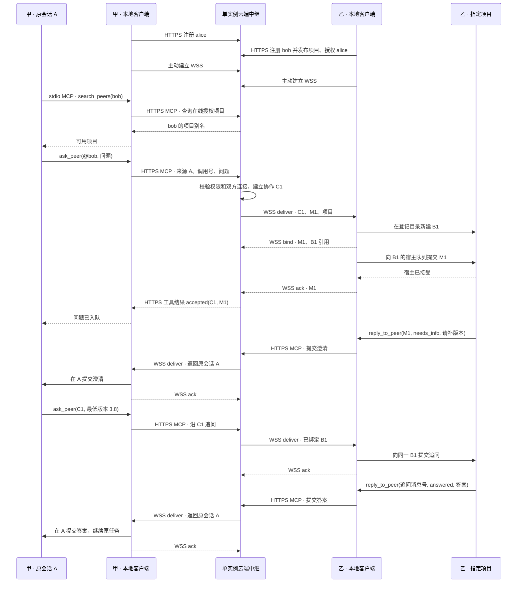

# Agent Relay 一期详细设计

甲在自己的 Codex 会话 A 中向 `@bob` 提问，乙的电脑在自己指定的项目（例如 `isho-service`）新建会话 B1。乙的回答回到 A；甲沿同一协作追问时仍进入 B1。双方的电脑和 Agent 在线、工具已获准时，人可以离开聊天窗口。

## 1. 部署和模块

云端只运行 **一个 Node.js 进程、一个监听端口**。同一个进程处理注册、目录查询、授权、在线投递和回执。所有服务端状态都在进程内存中。按单实例部署，滚动更换或重启进程都会结束这一批登记和协作。默认监听 `127.0.0.1:8787`，已有 HTTPS 网关可以转发 HTTP 和 WebSocket Upgrade，也可直接为服务指定 TLS 证书和私钥。[启动命令](../README.md#启动云端)

| 模块 | 职责 |
| --- | --- |
| `server/registry/` | 登记用户名和设备，验证管理、MCP 和收件凭据，保存目标及发件人授权，处理撤销。 |
| `server/collaboration/` | 按用户名、项目别名或协作号路由，核对调用幂等、会话绑定和宿主回执，提供参与者诊断。 |
| `server/http.js` | 同端口提供 HTTPS 注册与管理、MCP 调用和 WSS 投递。每个设备只有一个当前连接，按关闭事件和心跳更新在线状态。 |
| `client/mcp/`、`client/connector/` | 宿主通过 stdio 调用本机 MCP。注册直接访问云端，问答与搜索经用户私有 Unix socket 转给连接器。连接器为多个会话共用一条出站 WSS。 |
| `client/adapters/` | 把本地宿主提供的会话身份转换为中继引用，在收件项目创建或恢复会话并提交输入。目前提供 Codex 实现。 |
| `client/setup.js`、`client/settings.js`、`client/service.js` | 在本机选择项目、保管凭据、发布授权，并配置 MCP 和后台服务。 |

## 2. 两台电脑怎样往返

`accepted` 表示目的宿主已接受输入。对方模型会在自己的 turn 中处理，业务结论通过一次独立的 `reply_to_peer` 返回。云端只对当前 WSS 进行定向推送，双方可以处在不同网络。图中省略后续调用重复的 HTTP 受理结果和 WSS 回执确认。[可下载的全链路图](./flow.png) · [云端入口](../server/http.js)

## 3. 注册、找人和路由

1. 甲乙先在各自 Codex 中配置 `peer`，显式调用 `register_agent({username})`。设备在本地生成凭据，服务端保存摘要。同一进程中，相同登记可以重试，另一个身份无法占用已登记的用户名。注册可以在启动连接器之前完成。
2. 乙运行 `agent-relay setup --project /path/to/isho-service --target bob/isho-service --allow alice` 指定收件目录和授权人。登记目录与宿主原生线程号留在乙机。新增一个收件项目时，其他人只有取得该项目授权才可以查找和发问。
3. `search_peers({query:"bob"})` 返回有权提问且设备在线的项目。这里的在线指设备的 WSS 已认证且心跳有效。查询时间与发送时间可能不同，每次首问、追问和回信都要重新检查双方连接。
4. `ask_peer({username:"@bob",question})` 选取一个在线项目型目标。若有多个匹配目标，返回 `TARGET_AMBIGUOUS` 和可选别名，可改用 `ask_peer({target,question})`。按用户名发送的首问总是在所选项目里新建会话。乙也可以为已有会话发布专用别名，只通过明确指定该目标使用。
5. 云端为首问生成 `conversation_id` 和 `message_id`，保存甲的设备、A 的不透明引用和乙的目标。乙创建 B1 后先绑定引用，再提交首问。甲后续使用 `ask_peer({conversation_id,question})`，乙使用 `reply_to_peer({in_reply_to,outcome,text})`。回执或答复来自其他设备、其他会话时，服务端校验失败。
6. 取消某个发件人的项目权限或撤销设备后，相应协作停止接受新消息。其他联系人用同名账号重新登记时，需要项目所有者重新确认授权。

群成员、群邀请和群页面属于后续产品设计。一期按收件项目的 `--allow` 授权发现和收件。[工具参数](../protocol.js) · [登记与授权](../server/registry/registry.js) · [群目录草案](./group-directory.md)

## 4. 状态放在哪里

| 状态 | 位置与生命周期 |
| --- | --- |
| 用户名、凭据摘要、设备、项目别名和授权 | 云端进程内存。每次启动生成新的实例标识。 |
| 在线设备和待确认发送 | 云端内存。关闭、替换连接或心跳过期后停止向旧连接发送。 |
| 协作号、两端会话引用、消息号、调用指纹和回执 | 云端内存。供同进程内续问、去重和核对使用。消息元数据设有容量上限，满时可移除近期未使用且没有投递在途的旧协作。 |
| 问答正文 | 经云端转发给当前连接，云端不写磁盘，也不保存可供离线补投的副本。部署者能够看到经其进程转发的内容。 |
| 本地凭据、项目路径和会话映射 | 各自电脑。默认使用系统凭据库，显式选择文件模式时使用用户私有文件。连接器用本机 JSON 保存不含正文的会话引用和绑定。原生历史由各自的宿主管理。 |

## 5. 断线、重启与核对

| 事件 | 协议结果 | 用户操作 |
| --- | --- | --- |
| 对方收件设备已经离线 | 搜索中不可见，发问或回信返回 `PEER_OFFLINE`。调用方设备离线时返回 `DEVICE_OFFLINE`。 | 等双方在线，再主动调用。 |
| 帧已写入连接，但在确认前断线或超时 | `DELIVERY_UNCONFIRMED`。中继能确定编号时返回协作号和消息号。 | 核对收件会话或参与者诊断记录，再决定是否重新提问。 |
| 设备或本地连接器重连，云端仍在同一进程 | 在线目录随连接恢复。云端原协作和本地会话映射仍可用。 | 主动沿原协作继续。断线期间失败的调用不会自动补发。 |
| 云端重启、扩缩或替换实例 | 登记、权限、协作和去重记录清空。旧协作号失效。 | 两端重新调用 `register_agent`，确认对方身份后执行 `setup --allow` 重新发布。随后从原聊天发起新的协作。 |

每次问答都有调用者设备和来源会话。对同一个宿主调用号、同样参数的重复调用可复用结果；同号异参返回 `IDEMPOTENCY_CONFLICT`。投递未确认时，连接器不会定时重发正文。管理 API 的 `GET /v1/conversations/{id}` 仅限参与方查询该实例中的回执和错误码，结果不含正文。[云端协作路由](../server/collaboration/store.js) · [本地收件](../client/connector/inbound.js)

## 6. 可更换的本地 Agent

`client/adapters/` 是宿主的接入边界。新增本地宿主时，提供它的注册方式、可信调用识别与运行时实现，并在本地适配器表登记。云端继续使用相同的工具、设备、会话引用和 WSS 帧。

| 能力 | 适配器需提供的行为 |
| --- | --- |
| 配置宿主 | 定位可执行文件、注册本地 `peer` MCP 入口、构造设备后台使用的运行时实例 |
| `identifyCall(meta)` | 由宿主提供的元数据取得实际来源会话与调用 ID，可区分同时发问的多个窗口 |
| `createSession(target, conversationId)` | 在本机获准项目内创建可恢复的会话，返回原生会话 ID |
| `deliver(nativeId, frame)` | 向该原生会话提交带中间件消息号的输入，返回含 `submission_ref` 的确切接受证据 |
| `lookupDelivery(nativeId, messageId)` | 需要核对宿主投递记录时，按证据返回 `accepted`、`not_submitted` 或 `unknown` |

**Codex 的本机链路。** 适配器启动 `codex app-server proxy`。该进程按字节转发到本机 daemon 的 Unix 控制套接字。适配器在子进程管道上完成 WebSocket Upgrade，并将 JSON-RPC 放入 WebSocket 文本帧。Codex 内这条本地 WebSocket 与连接器到协作云端的 WSS 生命周期独立。`initialize` 时声明 `capabilities.experimentalApi: true`，随后发 `initialized`。[Codex App Server 初始化与线程 API](https://learn.chatgpt.com/docs/app-server) · [本项目代理实现](../client/adapters/codex/proxy.js)

1. 默认首问在本机配置的项目目录执行 `thread/start`，使用 `ephemeral: false`、`permissions: agent-relay-project` 和只含登记目录的 `runtimeWorkspaceRoots`。文件系统策略允许读取该工作区以及 Codex 的最小平台运行路径。macOS 实测能读项目内的文件，不能读取另一个普通项目的测试文件或在本项目创建文件。系统临时目录如 `/private/tmp` 也在该平台可读范围内。权限配置只在此类受托线程上生效。尚未写入第一条用户输入的新线程可直接在当前代理连接入队。
2. 对 A、B1 的后续投递按原生 ID 检查线程是否属于当前账号且可接收直接输入。已卸载的线程用 `thread/resume` 恢复，并核对返回的原 ID。恢复自动创建的受托线程时重新应用登记项目的权限配置。
3. `thread/queue/add` 将 `message_id` 写入 `clientUserMessageId`。返回的 `queuedSubmission.id` 及关联消息号必须有效。连接器只在确认该证据后回执。Codex 负责调度后续 turn，本地连接器不等待模型生成答案。
4. 适配器可分页读 `thread/queue/list`、`thread/turns/list`。待处理队列能按 `clientUserMessageId` 核对，已消费用户项能按 `clientId` 核对。两处都查不到时，适配器返回 `unknown`。这些队列能力依赖 Codex 版本和正在运行的本机 daemon。[Codex 队列行为测试（固定版本）](https://github.com/openai/codex/blob/ad9d659a8491fc5169a00dcf7b7e6ca8a87adf69/codex-rs/app-server/tests/suite/v2/thread_queue.rs) · [本项目 Codex 适配器](../client/adapters/codex/index.js)

**切换宿主。** 例如乙希望改用 Claude Code，可为实现并验收后的新适配器发布新收件目标，再移动同一别名。此后新事项进入新宿主，旧事项保留受理时绑定的旧目标和会话。继续处理旧事项须保留旧适配器和本机状态。Claude Code 的宿主调用识别、忙碌窗口投递、关闭后恢复及事后核对均需独立实现和验证。

## 7. 部署验证

仓库的集成测试通过两个独立的本地 MCP 客户端、真实 HTTPS/WSS 以及可记录投递的宿主替身，验证在线查找、在指定目录创建 B1、回到 A、追问仍在 B1、新事项新建 B2，以及离线失败后重连不会补投。另一组测试在相同网络地址重新启动空中继，检查旧凭据、目标和授权失效，双方可从原本地配置重新登记并显式授权。[在线多轮测试](../test/relay-e2e.test.js) · [重启与重新登记测试](../test/registration-e2e.test.js)

两台真实电脑验收时，分别接入公网中继，保持已登录的 Codex 和后台连接器运行。在乙的指定项目列表确认 B1、B2，在甲的原会话确认澄清和答案；再令乙离线，确认目录移除、发送失败，唤醒后仅收到新发起的消息。安装脚本和本机 Codex 适配器的检查方式见[项目首页](../README.md)。
