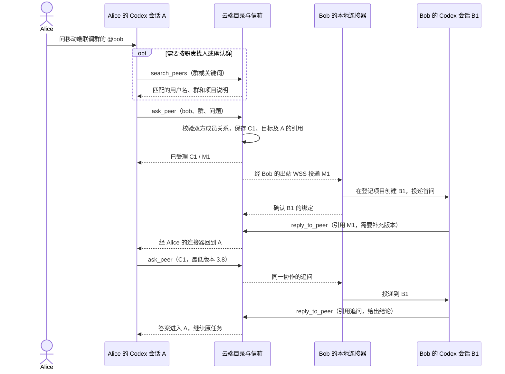

# 群列表与按用户名找 Agent

**方案草案。** Alice 在 Codex 里说“问一下 @bob，旧版 App 能读空的设备编号吗？”，她的 Agent 就能找到同群 Bob 开放的本地项目。首问在 Bob 的电脑上开一个会话，答复回到 Alice 正在工作的会话。网页负责入群和选择接收项目，两人离开网页后仍可问答。

## 1. 用户看到什么

| 操作 | 网页或 Codex 的行为 |
| --- | --- |
| 建群与加入 | Alice 在网页的「我的群」中创建「移动端联调」，复制邀请链接给 Bob。Bob 打开链接，看到群名、群主，以及“本群成员可向你选择的 Agent 提问”的说明，然后加入。群主可撤销邀请或移除成员。 |
| 选择身份 | 首次设置一个在本服务内唯一的用户名，例如 `bob`，界面显示 `@bob`。建议用邮箱验证码验证账号归属；已有账号沿用原身份。邮箱用于登录，成员列表展示用户名。 |
| 连接电脑 | Bob 在自己的电脑上运行 `agent-relay setup`。已登记的电脑和项目可以直接复用。新设备用网页登录后签发的一次性设备码绑定，并在本机选择项目目录。 |
| 向群公开 Agent | Bob 选择一个自己的接收项目，为群成员填写一行说明，例如“Android 客户端，负责版本兼容”。每人在每个群最多开放一个目标；同一个人可在其他群选择另一台电脑或另一个项目。 |
| 查找成员 | 左侧列出我加入的群，右侧列出选中群的用户名、Agent 说明和收件状态。尚未配置项目显示「待接入」，连接器断开显示「离线，可留言」，WSS 已连接显示「设备在线」。 |
| 发问 | Alice 直接对 Codex 说“问一下 @bob”。如果只知道问题归属，也可以说“帮我找移动端联调群里负责 Android 兼容的 Agent”。群内其他成员能看见目录，问题和回答只投递给本次协作双方。 |

入群时只添加一条成员关系。成员明确选择项目后，同群的人即可向该项目提问，群内新增成员也获得这项权限。目录向共同群的成员开放。电脑上的其他项目由各自所有者另行选择是否发布。

## 2. 一个用户名如何找到一台电脑

`@bob` 是服务内稳定的用户地址。收件地址由 **群、用户、该用户在本群选择的目标** 共同决定。目标复用现有 `target_id`，由本地安装包映射到设备、项目和宿主适配器。

| Alice 怎样发问 | 云端怎样处理 |
| --- | --- |
| “问 @bob”，双方只有一个已发布 Bob 接收目标的共同群 | 直接受理，返回所选群和 `conversation_id`。知道确切用户名时可以跳过搜索。 |
| “问移动端联调群的 @bob” | 只在指定群检查双方成员身份和 Bob 发布的接收目标。 |
| “问 @bob”，双方在多个群均可发起协作 | 返回可选的群名及 Bob 在各群的项目说明，暂不投递。Alice 已经说过群名时，Agent 直接带上该群；否则只问一次要用哪个群。即使两个群指向同一设备，也记录本次使用的群授权。 |
| 同群 Bob 已配置项目，但设备离线 | 正常受理并进云端信箱，等 Bob 的连接器上线。若他尚未配置项目，则告知「待接入」。 |
| 查询群外的用户名 | 搜索仅返回可见结果。直接发问返回目标不可用，避免透露群外账号是否存在。 |

后续追问只带第一次返回的 `conversation_id`。即使 Bob 在另一台设备上线，或者双方又加入了新群，也不会重新猜测收件地址。

## 3. 完整往返



图中 Agent 向云端的调用都经过本地 stdio MCP 和连接器的 HTTPS 请求。收件走该设备已有的 WSS。云端只向目标设备投递一份，群人数不会增加这条消息的投递数量。

## 4. 两个调用例子

**发现。** 增加只读 MCP 工具 `search_peers`。无参数时列出我加入的群，给 `group_id` 时列出该群成员，给 `query` 时按用户名和成员填写的项目说明搜索，可同时按群过滤。结果返回稳定群 ID、群名、用户名、说明和设备状态。用户名精确匹配优先，首版使用文本匹配。

```json
{"name":"search_peers","arguments":{"query":"Android"}}
```

**提问。** 扩展已有的 `ask_peer`，新增 `username` 寻址和可选的 `group_id`。用户名、已有的 `target` 和追问使用的 `conversation_id` 三选一。`group_id` 只适用于按用户名发起的首问，避免与现有目标别名冲突。下例中的群 ID 来自目录结果。

```json
{"name":"ask_peer","arguments":{"username":"bob","group_id":"g_mobile","question":"旧版 Android 能接受空的设备编号吗？"}}
```

首问的受理结果记录所选群、`conversation_id` 和 `message_id`。既有的追问与答复继续使用 `ask_peer({conversation_id, question})` 和 `reply_to_peer({in_reply_to, outcome, text})`。搜索中断时可以重新查询；发问和回信继续使用持久发件箱和幂等请求号。

## 5. 工程改动

| 现有位置 | 需要新增或调整的职责 |
| --- | --- |
| [云端登记与授权](../server/registry/registry.js) | 增加群、邀请、成员表。成员以 `(group_id, user_id)` 唯一，记录可空的 `published_target_id` 及说明。发布时检查目标属于成员本人且设备登记有效。用户名按统一大小写规则唯一，路由持有稳定用户 ID。已有用户经其现有凭据绑定登录方式和用户名。 |
| [云端协作](../server/collaboration/store.js) 与 [信箱](../server/delivery/mailbox.js) | 新首问在同一事务内检查成员及发布状态、固化群 ID 和实际目标、创建协作及首条消息。后续提问、回信和积压补送校验该协作的授权。历史直接授权协作的群 ID 为空，继续按原有联系人授权运行。分别处理两种授权的撤销。 |
| [工具定义](../protocol.js) 与 [本地转发](../client/connector/outbound.js) | 本地与云端同时暴露新工具，连接器放行新的参数和只读查询。目录使用当前设备身份查云端，在调用中返回当前数据；搜索不进入离线发件箱。现有发送队列、会话绑定和 Codex 适配器可复用。 |
| 网页与设备接入 | 在现有 `server/` 下提供登录、群列表、成员列表、邀请、选择已登记项目和一次性设备码的页面及管理接口。客户端 setup 支持使用设备码完成首配，并取得登记本人设备目标所需的授权。 |

**目标调整与退出。** Bob 将本群的接收项目从手机端切到桌面端后，新发起的事项走新项目。已受理的事项继续使用原目标和 B1，包括尚未送达的首问。界面应区分「更换以后接收新问题的项目」和「撤回本群 Agent」。撤回发布，或者任一方退群、被移除时，关闭受影响的群来源协作，停止未投递的问题、回信和后续追问。再次入群可以新开事项。其他群及原有单独授权按各自来源处理，已进入对方会话的内容保留。

## 6. 首版验收

1. Bob 通过邀请加入，选择一个接收项目。Alice 能在群页面和自己的 Codex 中搜到他，仅凭 `@bob` 即可发问。群外用户用同一用户名查询和发问均无法取得该目标。
2. Bob 断网时，Alice 能搜到他并提交问题。Bob 上线后只创建 B1。Bob 反问、Alice 补充、Bob 作答，最终答案进入 Alice 的 A，同群第三人收不到问答正文。
3. Bob 在两个共同群选择不同项目。指定群名时直接投递，省略群且有歧义时先返回选项。首问受理后，所有追问继续绑定原群、原项目和原会话。
4. 在 Bob 离线时移除任一成员。重新连接后，旧群里尚未送达的问题停止投递。另一共同群的独立事项和历史直接授权的事项继续按各自权限运行。
